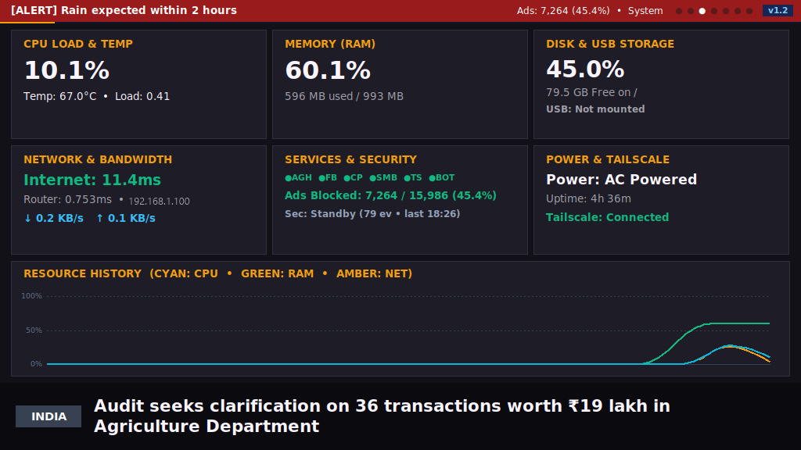
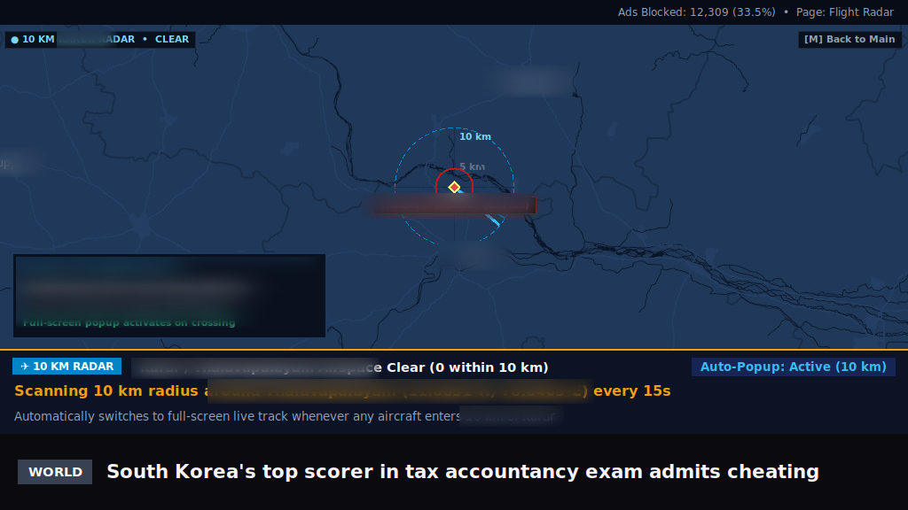
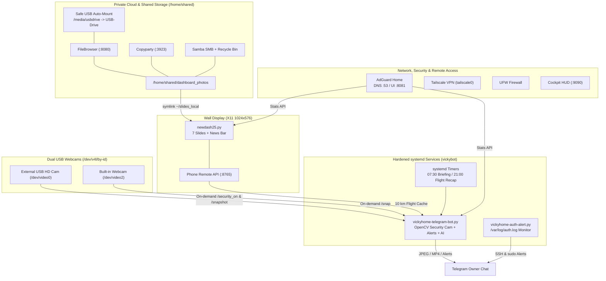

# All-in-One Low-RAM Home Server Suite (`homeserver_2026`)

Turn an old **1 GB RAM / 32-bit laptop** (like a Lenovo IdeaPad S10e running Debian) or a **Raspberry Pi** into a complete, self-hosted home server & smart wall display:

- **Network-Wide Ad Blocker** (AdGuard Home DNS)
- **Private Cloud & LAN File Server** (FileBrowser + Copyparty + Samba SMB with Recycle Bin + Safe USB Auto-Mount)
- **Zero-Config Remote Access** (Tailscale VPN + UFW Firewall + Cockpit Admin HUD)
- **7-Slide Fullscreen Wall Dashboard** (Clock, Weather, System/AdGuard Stats, All-Sky ISS Dome & ISRO Launches, 10 km Auto-Popup Flight Radar, and File-Server Photo Frame)
- **Hardened 2-Way Telegram Ops Bot** (On-demand OpenCV USB Security Camera with JPEG + 8s MP4 alerts, Daily Briefings, Overhead Flight Alerts, ISS Alerts, Gemini AI, and Real-Time SSH/`sudo` Intrusion Alerts)

---

## Live Wall Dashboard Screenshots (`1024x576` — `v1.2`)

| Main Dashboard (Clock, Weather, Events & Online Photos) | Upgraded System Health v1.2 (Bandwidth, Services & Security) |
| :---: | :---: |
|  |  |

| Full-Screen All-Sky ISS Dome & ISRO Manifest | Full-Screen 10 km Local Flight Radar (Auto-Popup) |
| :---: | :---: |
|  |  |

| Full-Screen File-Server Photo Gallery (Blurred Backdrop) |
| :---: |
|  |

### What's New in `newdash` v1.2
- **Modern Header & Navigation:** `v1.2` version pill, clickable 7-slide indicator dots, smooth 2px slide-cycle progress bar, dark pill photo captions, instant first photo load on startup, and live red `SEC ARMED` header pill whenever the USB security camera is armed.
- **Complete Multi-Theme Engine + OLED Mode:** Full theme synchronization across all slides (`Auto`, `Day`, `Evening`, `Night`, and pure-black `OLED`), switchable via `[T]` or the Phone Remote.
- **Live Network, Storage, Service & Security Telemetry (System Slide):** Real-time RX/TX bandwidth (`KB/s` / `MB/s` from `/proc/net/dev`), 3-series `CPU • RAM • NET` sparkline with axis guides, USB flash-drive mount & free-space telemetry, live core service health chips (`AGH`, `FB`, `CP`, `SMB`, `TS`, `BOT`), and live Security Camera armed state + event counter.
- **Redesigned Offline-First Phone Remote (`:8765`):** Live 5-second telemetry dashboard (`/api/status`), brightness slider (`20%`–`100%`), instant theme switcher, custom banner duration & clear button, custom countdown timer, quick links to FileBrowser/Copyparty/AdGuard/Cockpit, and toast feedback.
- **Network Resilience Hardening:** IPv4-first DNS resolution across dashboard, Telegram bot, and SSH/sudo auth monitor; pooled HTTP retries with timeouts (including RSS feeds); multi-threaded Phone Remote server; exponential backoff; and multi-attempt Telegram alert/media delivery.

---

## Complete Server Stack & Port Map

| Service | Port / Protocol | Purpose |
| :--- | :---: | :--- |
| **AdGuard Home** | `53/udp,tcp` & `:8081` (`:3000` setup) | Network-wide DNS ad & tracker blocking for every phone/TV on your Wi-Fi |
| **FileBrowser** | `:8080` | Clean web file manager over `/home/shared` (upload wall photos to `dashboard_photos`) |
| **Copyparty** | `:3923` | Ultra-fast drag-and-drop file upload, resumable transfers & `/shr` share links |
| **Samba (SMB)** | `445/tcp` | Native Windows/macOS/Android LAN drive (`\\<server-ip>\shared`) with `.recycle` trash |
| **Wall Dashboard & Remote** | X11 + `:8765` | 7-slide fullscreen Tkinter display + mobile browser control panel |
| **Cockpit Server HUD** | `:9090` (HTTPS) | Browser-based Linux system monitor, terminal & service manager |
| **Tailscale VPN** | `tailscale0` | Encrypted remote access to all services from anywhere without router port-forwarding |
| **Telegram Ops & Security Bot** | Outbound HTTPS | 2-way owner-only Telegram bot + on-demand OpenCV USB security camera |
| **SSH & `sudo` Auth Alert** | Outbound HTTPS | Instant phone push alerts (Telegram / `ntfy.sh`) on SSH logins, brute-force & `sudo` |
| **Safe USB Auto-Mount** | `udev` | Plug in any formatted USB flash drive -> auto-mounts into `/home/shared/USB-Drive` |

---

## Full-Stack Architecture



---

## One-Command Full Installation (Debian / Ubuntu / Raspberry Pi OS)

Clone the repository onto your server and run the interactive installer (`install.sh` lets you pick **every** component or skip any you don't need — pass `--all` to install everything automatically):

```bash
git clone https://github.com/techtrainer20/homeserver_2026.git
cd homeserver_2026
sudo bash install.sh
```

After `install.sh` completes, finish these 4 quick personalization steps:

1. **AdGuard Home Ad-Blocker Setup (`:3000` -> `:8081`):**
   - Open `http://<server-ip>:3000` in your browser.
   - Set **Admin Web Interface** port to `8081` (so FileBrowser keeps `8080`) and **DNS Server** port to `53`.
   - Point your home Wi-Fi router's Primary DNS to `<server-ip>` to block ads across all phones, TVs, and laptops automatically.
2. **Dashboard Settings (`~/dashboard_config.json`):**
   - Set your `location_name`, `latitude`, `longitude`, `phone_control.token`, and `adguard` credentials.
   - Upload photos (`.jpg`, `.jpeg`, `.png`, `.webp`, `.bmp`, `.gif`) into `/home/shared/dashboard_photos` via FileBrowser (`:8080`), Copyparty (`:3923`), or Samba (`\\<server-ip>\shared`) — they appear automatically on **Page 6 (`Server Photos`)**!
3. **Telegram Bot & Auth Alerts (`/etc/vickyhome-tgbot.conf` & `/etc/vickyhome-alerts.conf`):**
   - Create a bot via `@BotFather` and get your numeric Telegram user ID via `@userinfobot`.
   - Fill in `TELEGRAM_BOT_TOKEN`, `TELEGRAM_CHAT_ID`, and optionally `GEMINI_API_KEY` and `ADGUARD_PASS`, then start the services:
     ```bash
     sudo systemctl start \
       vickyhome-telegram-bot.service \
       vickyhome-auth-alert.service \
       vickyhome-briefing.timer \
       vickyhome-flight-recap.timer
     ```
4. **Tailscale Remote Access:**
   - Run `sudo tailscale up` and sign in on both your server and phone to access FileBrowser, Copyparty, AdGuard Home, Cockpit, and the Dashboard Phone Remote securely from anywhere in the world.

---

## Feature Highlights

### 7-Slide Fullscreen Wall Dashboard (`dashboard/newdash25.py`)
Engineered in pure Python (`tkinter` + `Pillow`) with zero browser/Electron overhead (~1 GB RAM friendly):
- **Page 0 — Main:** Clock (`12h`/`24h`), live weather + animated icon, upcoming reminders, and online Bing/Picsum photos.
- **Page 1 — Weather Detail:** 12-hour forecast & rain-chance chart, sunrise/sunset, and moon phase.
- **Page 2 — System Health (`v1.2`):** CPU/RAM/Network 3-series sparklines, load average, disk & USB drive free space, router/internet ping, real-time RX/TX bandwidth, live core service chips (`AGH`, `FB`, `CP`, `SMB`, `TS`, `BOT`), Security Camera armed/event status, Tailscale status, and live **AdGuard Home** blocked queries.
- **Page 3 — Money & Quotes:** Currency/metals widget & daily quote card.
- **Page 4 — All-Sky ISS Dome & Space:** Stereographic sky dome with animated visible ISS pass arcs (`max elevation >= 25°`), real-time ISS telemetry, sun/moon almanac, and upcoming ISRO launches (`42° NE` beacon).
- **Page 5 — 10 km Flight Radar (Auto-Popup):** Dark CartoDB map tiles with `5 km` / `10 km` rings. Automatically switches full-screen whenever an aircraft enters `10 km` (`adsb.fi`/`OpenSky` + `adsbdb` routes) and restores the previous slide once clear.
- **Page 6 — Server Photos Gallery:** Recursively displays uploaded photos from `/home/shared/dashboard_photos` with EXIF rotation and an ambient blurred backdrop (zero portrait cropping).

### Hardened Telegram Bot & On-Demand OpenCV USB Security Camera (`telegram-bot/vickyhome-telegram-bot.py`)
Runs as unprivileged user `vickybot` inside a strict `systemd` sandbox (`ProtectSystem=strict`, `ProtectHome=yes`, `PrivateTmp=yes`, `DevicePolicy=closed`, strict private-chat owner-only guard):
- **Inactive by Default (0% Idle CPU):** USB webcam stays closed until you send `security` or `/security_on`.
- **Motion + Person Detection:** Streams `640x480` V4L2 frames via `ffmpeg` into OpenCV `MOG2` background subtraction + conditional `HOG` person detection (`0.06s`/check).
- **Instant Photo + 8s Video Clip:** Immediately sends an annotated JPEG (`PERSON` / `MOTION` bounding boxes + timestamp) and an ~8-second H.264 MP4 clip (including ~1.8s pre-motion buffer) with a `45s` anti-spam cooldown and persistent timestamped log (`/var/lib/vickyhome-tgbot/security_events.log`).
- **Dual Camera Support:** External USB webcam handles `/security_on` & `/snapshot`; built-in laptop webcam stays separate for `/snap` (using persistent `/dev/v4l/by-id/` symlinks).
- **Generic USB Webcam Fix (`udev/99-usb-webcam-power.rules`):** Prevents cheap UVC webcams from hitting kernel `-75`/`-32` (`Input/output error`) after USB autosuspend.

---

## Telegram Commands & Dashboard Shortcuts

| Telegram Command | Action |
| :--- | :--- |
| `/security_on` or `security` | Arm USB webcam motion & person security monitoring |
| `/security_off` or `security off` | Disarm monitoring and close webcam immediately |
| `/security_status` | Show armed state, cooldown, camera path & recent event log |
| `/snapshot` | Instant photo from external USB security webcam |
| `/snap` (`/cam`, `/photo`) | Instant photo from built-in webcam |
| `/flights` / `/recap` | Live aircraft within `10 km` & daily `9:00 PM` recap |
| `/sky` / `/briefing` | ISS passes, ISRO launches, weather & morning server briefing |
| `/status`, `/temp`, `/ram`, `/disk`, `/top`, `/services`, `/adguard` | Live server diagnostics & AdGuard stats |
| `/ai <question>` or plain text | Gemini AI assistant (`/clear` resets chat memory) |

**Dashboard Keyboard Shortcuts:** `[<-/->]` Switch slide · `[Space]` Pause rotation · `[N]` Next photo · `[P]` Server Photos · `[S]` Sky Dome · `[M]` Flight Radar · `[1-3]` Select ISS pass · `[T]` Cycle theme (`Day`/`Evening`/`Night`/`OLED`) · `[B]` Night dim · `[F]` 12/24h · `[H]` Hints · `[Esc]` Exit

---

## Repository Layout

```text
homeserver_2026/
├── install.sh                             # Interactive full-stack home server installer
├── README.md                              # Full architecture & setup guide
├── LICENSE                                # MIT License
├── requirements.txt                       # Python dependencies
├── dashboard/
│   ├── newdash25.py                       # 7-slide fullscreen wall dashboard + :8765 remote
│   ├── start_dashboard.sh                 # Single-instance launcher with crash-guard fallback
│   ├── dashboard.desktop.example          # X11 desktop autostart entry
│   └── dashboard_config.example.json      # Sanitized dashboard configuration template
├── telegram-bot/
│   ├── vickyhome-telegram-bot.py          # Hardened 2-way Telegram bot + OpenCV security camera
│   └── vickyhome-auth-alert.py            # Real-time SSH & sudo login/intrusion alert daemon
├── config/
│   ├── vickyhome-tgbot.conf.example       # Sanitized Telegram bot config template
│   ├── vickyhome-alerts.conf.example      # Sanitized SSH/sudo alert config template
│   ├── copyparty.env.example              # Sanitized Copyparty credentials template
│   └── smb.conf.example                   # Samba LAN share + Recycle Bin config template
├── scripts/
│   └── auto_usb_mount.sh                  # Safe, non-destructive USB drive auto-mount script
├── systemd/
│   ├── filebrowser.service                # FileBrowser (:8080)
│   ├── copyparty.service                  # Copyparty (:3923)
│   ├── vickyhome-telegram-bot.service     # Hardened Telegram bot & security cam
│   ├── vickyhome-auth-alert.service       # Real-time SSH/sudo alert monitor
│   ├── vickyhome-briefing.service/.timer  # Daily 7:30 AM briefing
│   └── vickyhome-flight-recap.service/.timer # Daily 9:00 PM flight recap
├── udev/
│   ├── 99-auto-usb-mount.rules            # Safe USB partition auto-mount rule
│   └── 99-usb-webcam-power.rules          # Disables broken UVC USB webcam autosuspend
└── docs/screenshots/                      # Privacy-blurred live dashboard screenshots
```

---

## Security & Safety Notes
- **Zero Secrets Committed:** All tokens, passwords, API keys, and chat IDs are strictly excluded via `.gitignore`; real configurations live only locally under `/etc/` and `~/dashboard_config.json`.
- **Safe USB Auto-Mount:** `scripts/auto_usb_mount.sh` strictly mounts already-formatted removable partitions and **never** runs `fdisk` or `mkfs` on disks.
- **UFW Firewall Safety:** `install.sh` opens `22/tcp` (SSH) before enabling UFW to prevent remote lockouts.

---

## License
MIT License — see [LICENSE](LICENSE).
