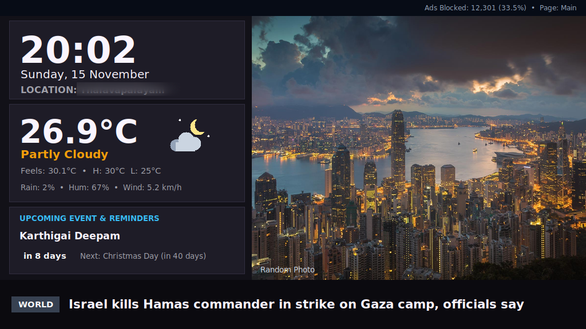
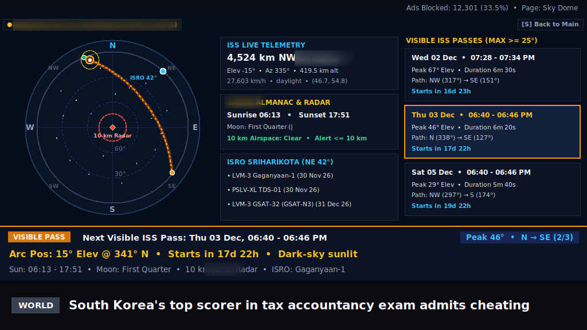
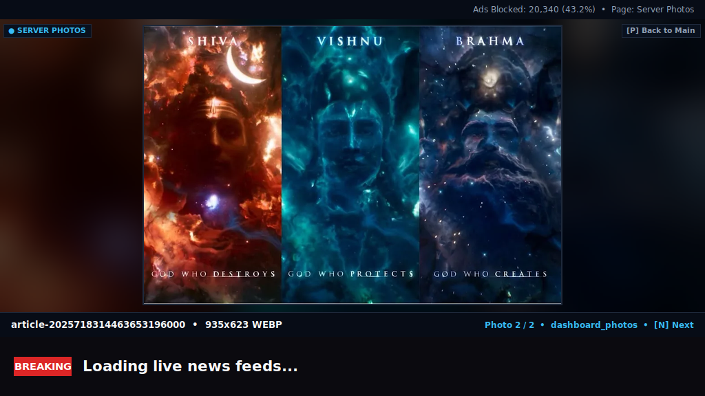
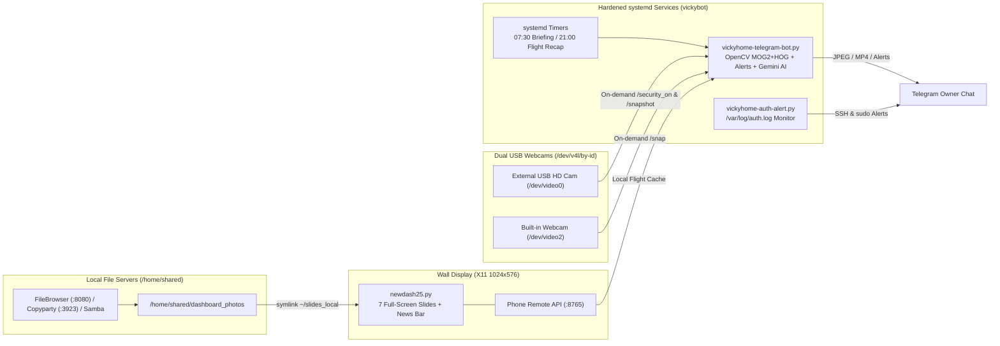

# Home Server Wall Dashboard & Hardened Telegram Automation Suite (`vickyhome`)

Turn an old **1 GB RAM / 32-bit laptop** (like a Lenovo IdeaPad S10e running Debian) or a **Raspberry Pi** into an always-on smart wall dashboard, local ADS-B flight radar, ISS/space sky dome, file-server photo frame, on-demand OpenCV USB security camera, and hardened 2-way Telegram ops bot.

---

## Live Screenshots (`1024x576` Wall Display)

| Main Dashboard (Clock, Weather, Events & Online Photos) | Full-Screen All-Sky ISS Dome & ISRO Manifest |
| :---: | :---: |
|  |  |

| Full-Screen 10 km Local Flight Radar (Auto-Popup) | Full-Screen File-Server Photo Gallery (Blurred Backdrop) |
| :---: | :---: |
|  |  |

---

## Key Features

### 1. Seven-Slide Fullscreen Wall Dashboard (`dashboard/newdash25.py`)
Built in pure Python (`tkinter` + `Pillow`) with zero Electron/browser bloat so it runs smoothly inside ~1 GB RAM:
- **Page 0 — Main:** Clock (`12h`/`24h`), live weather + animated icon, upcoming festival/custom reminders, and an online Bing/Picsum photo panel.
- **Page 1 — Weather Detail:** 12-hour temperature & precipitation chart plus sunrise/sunset and moon phase.
- **Page 2 — System Health:** CPU/RAM sparklines, disk space, LAN/Internet ping, Tailscale status, Docker container count, and live **AdGuard Home** ad-block metrics.
- **Page 3 — Money & Quotes:** Live currency/gold-silver widget & daily quote card.
- **Page 4 — All-Sky ISS Dome & Space:** Stereographic sky dome centered on your GPS coordinates with animated visible ISS pass arcs (`max elevation >= 25°`), real-time ISS telemetry, sun/moon almanac, and upcoming ISRO launches from Sriharikota (`42° NE` azimuth beacon).
- **Page 5 — 10 km Overhead Flight Radar (Auto-Popup):** Dark CartoDB map tiles with `5 km` and `10 km` radar rings. Whenever any aircraft enters the `10 km` radius (via `adsb.fi` / `OpenSky` + `adsbdb` routes), the display **automatically switches full-screen** to track its route arc, altitude, heading, and progress bar, then returns to the previous slide once clear.
- **Page 6 — Server Photos Gallery:** Recursively scans your file-server folder (`~/slides_local` -> `/home/shared/dashboard_photos`) for `.jpg`, `.jpeg`, `.png`, `.webp`, `.bmp`, and `.gif` files, applies EXIF auto-rotation, and frames both portrait and landscape photos cleanly over a fast ambient blurred backdrop with zero cropping.
- **Bottom Breaking News Ticker & Phone Control Web UI:** Smooth multi-feed RSS news bar with keyword hide/highlight filters, plus a lightweight LAN web remote (`http://<server-ip>:8765/?token=...`) to switch pages, skip photos, push banners, start countdown timers, or dim brightness.

### 2. Hardened 2-Way Telegram Bot & USB Security Camera (`telegram-bot/vickyhome-telegram-bot.py`)
Runs as an unprivileged `vickybot` user inside a strict `systemd` sandbox (`ProtectSystem=strict`, `ProtectHome=yes`, `PrivateTmp=yes`, `DevicePolicy=closed`, strict owner-only private chat verification):
- **On-Demand USB Webcam Security Mode (0% Idle CPU):**
  - Inactive by default on boot (camera closed, LED off).
  - Send `security` or `/security_on` when leaving home -> opens the secondary USB webcam (`ffmpeg` V4L2 -> `OpenCV` `MOG2` background subtraction + conditional `HOG` person detection).
  - On motion/person detection: immediately sends an **annotated JPEG snapshot** (with green `PERSON` / amber `MOTION` boxes + timestamp), records an **~8-second H.264 MP4 clip** (including ~1.8s pre-motion buffer), sends it via Telegram `sendVideo`, enforces a `45s` cooldown, and logs every event with timestamp to `/var/lib/vickyhome-tgbot/security_events.log`.
  - Send `/security_off` when returning home to immediately stop monitoring and release the webcam.
  - Supports **dual cameras** independently via persistent `/dev/v4l/by-id/` symlinks (`/snapshot` for the external USB security webcam, `/snap` for a built-in laptop camera).
- **Real-Time Alerts & Scheduled Reports:**
  - Instant overhead flight alerts (`<= 10 km`) and a **9:00 PM daily flight recap** highlighting low-altitude passes (`< 10,000 ft`), private jets, and helicopters (`vickyhome-flight-recap.timer`).
  - **7:30 AM daily morning briefing** with local weather, sunrise/sunset, moon phase, server health, and AdGuard stats (`vickyhome-briefing.timer`).
  - Upcoming visible **ISS pass** & **ISRO launch** alerts.
  - Optional built-in **Gemini AI** chat assistant (`/ai` or plain text).

### 3. Real-Time SSH & `sudo` Intrusion Monitor (`telegram-bot/vickyhome-auth-alert.py`)
Tails `/var/log/auth.log` and sends instant Telegram / `ntfy.sh` push alerts on SSH logins, failed SSH brute-force probes (classified as Home LAN / Tailscale VPN / External Internet), and `sudo` root commands.

---

## Architecture Overview



---

## Telegram Commands

| Command / Message | Description |
| :--- | :--- |
| `/security_on` or `security` | Arm USB webcam motion & person security monitoring |
| `/security_off` or `security off` | Disarm monitoring and release webcam (0% idle CPU) |
| `/security_status` | Show armed state, cooldown, camera path & recent detection log |
| `/snapshot` | Capture and send an instant photo from the external USB security webcam |
| `/snap` (`/cam`, `/photo`) | Capture an on-demand photo from the built-in camera |
| `/flights` | Live aircraft currently within 10 km |
| `/recap` | Today's 10 km overhead flight recap & interesting sightings |
| `/sky` (`/iss`, `/launches`) | Sun/Moon almanac, live ISS distance, next visible passes & ISRO launches |
| `/briefing` | Weather, server health, and AdGuard Home summary |
| `/status`, `/temp`, `/ram`, `/disk`, `/top`, `/services`, `/adguard` | On-demand server diagnostics |
| `/ai <question>` or plain text | Ask Gemini AI (with `/clear` to reset short-term history) |

### Dashboard Keyboard Shortcuts
- `[<-]` / `[->]` — Previous / Next slide
- `[Space]` — Pause / resume auto-rotation
- `[N]` — Next photo (Online photo on Page 0, Server photo on Page 6)
- `[P]` — Toggle full-screen **Server Photos** (`Page 6`)
- `[S]` — Toggle full-screen **Sky & ISS Dome** (`Page 4`)
- `[M]` — Toggle full-screen **10 km Flight Radar** (`Page 5`)
- `[1]`–`[3]` — Select upcoming ISS pass arc on Sky Dome
- `[B]` — Toggle night mode & screen dimming | `[F]` — Toggle 12h/24h clock | `[H]` — Show key hints | `[Esc]` — Exit

---

## Quick Setup Guide (Debian / Ubuntu / Raspberry Pi OS)

### 1. System Packages
```bash
sudo apt-get update
sudo apt-get install -y --no-install-recommends \
  python3 python3-tk python3-pil python3-pil.imagetk python3-requests \
  python3-feedparser python3-psutil python3-opencv python3-numpy \
  ffmpeg fswebcam v4l-utils x11-xserver-utils
```

### 2. Install the Wall Dashboard
```bash
cp dashboard/newdash25.py ~/newdash25.py
cp dashboard/start_dashboard.sh ~/start_dashboard.sh
chmod +x ~/newdash25.py ~/start_dashboard.sh

cp dashboard/dashboard_config.example.json ~/dashboard_config.json
nano ~/dashboard_config.json   # Set your city, lat/lon, AdGuard password & phone token
```

Link your file server photos folder so uploaded images appear on **Page 6 (`Server Photos`)**:
```bash
mkdir -p /home/shared/dashboard_photos
ln -s /home/shared/dashboard_photos ~/slides_local
```

Start the dashboard (or add `~/start_dashboard.sh` to your LXDE/XFCE autostart):
```bash
~/start_dashboard.sh &
```

### 3. Install the Hardened Telegram Bot & Security Camera
Create a dedicated unprivileged service user and state directory:
```bash
sudo useradd -r -s /usr/sbin/nologin -G video vickybot
sudo mkdir -p /var/lib/vickyhome-tgbot
sudo chown vickybot:vickybot /var/lib/vickyhome-tgbot
sudo chmod 0700 /var/lib/vickyhome-tgbot
```

Install the bot and config:
```bash
sudo install -m 0755 telegram-bot/vickyhome-telegram-bot.py /usr/local/bin/vickyhome-telegram-bot.py
sudo install -m 0755 telegram-bot/vickyhome-auth-alert.py /usr/local/bin/vickyhome-auth-alert.py

sudo cp config/vickyhome-tgbot.conf.example /etc/vickyhome-tgbot.conf
sudo chown vickybot:vickybot /etc/vickyhome-tgbot.conf
sudo chmod 0400 /etc/vickyhome-tgbot.conf
sudo nano /etc/vickyhome-tgbot.conf   # Add Telegram bot token, chat ID, optional Gemini/AdGuard creds

sudo cp config/vickyhome-alerts.conf.example /etc/vickyhome-alerts.conf
sudo chmod 0640 /etc/vickyhome-alerts.conf
sudo nano /etc/vickyhome-alerts.conf
```

Find your persistent webcam device IDs (`ls -la /dev/v4l/by-id/`) and optionally override `SECURITY_DEVICE` / `SNAP_DEVICE` in `/etc/vickyhome-tgbot.conf`.

If your generic USB webcam experiences UVC `-75`/`-32` (`Input/output error`) after idle USB autosuspend, install the udev rule (updating `idVendor`/`idProduct` from `lsusb`):
```bash
sudo install -m 0644 udev/99-usb-webcam-power.rules /etc/udev/rules.d/99-usb-webcam-power.rules
sudo udevadm control --reload-rules && sudo udevadm trigger --subsystem-match=usb
```

Enable the hardened `systemd` services and timers:
```bash
sudo cp systemd/vickyhome-*.service systemd/vickyhome-*.timer /etc/systemd/system/
sudo systemctl daemon-reload
sudo systemctl enable --now \
  vickyhome-telegram-bot.service \
  vickyhome-auth-alert.service \
  vickyhome-briefing.timer \
  vickyhome-flight-recap.timer
```

---

## Security & Privacy Notes
- **Never commit real `.conf` or `dashboard_config.json` files** — `.gitignore` blocks them automatically.
- `vickyhome-telegram-bot.py` enforces **strict owner-only private chat authorization** (ignores groups, channels, bots, and forwarded messages).
- Systemd services isolate filesystem writes exclusively to `/var/lib/vickyhome-tgbot` and limit `/dev` access strictly to video nodes.

---

## License
MIT License — see [LICENSE](LICENSE). Feel free to fork, remix, and adapt these ideas for your own old-laptop or Raspberry Pi home server!
